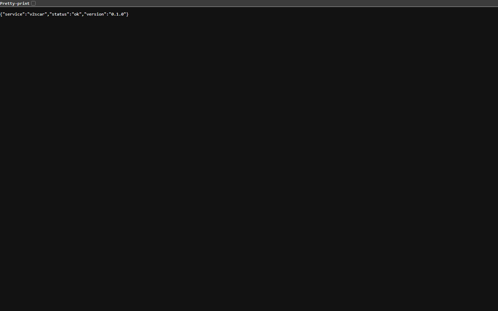
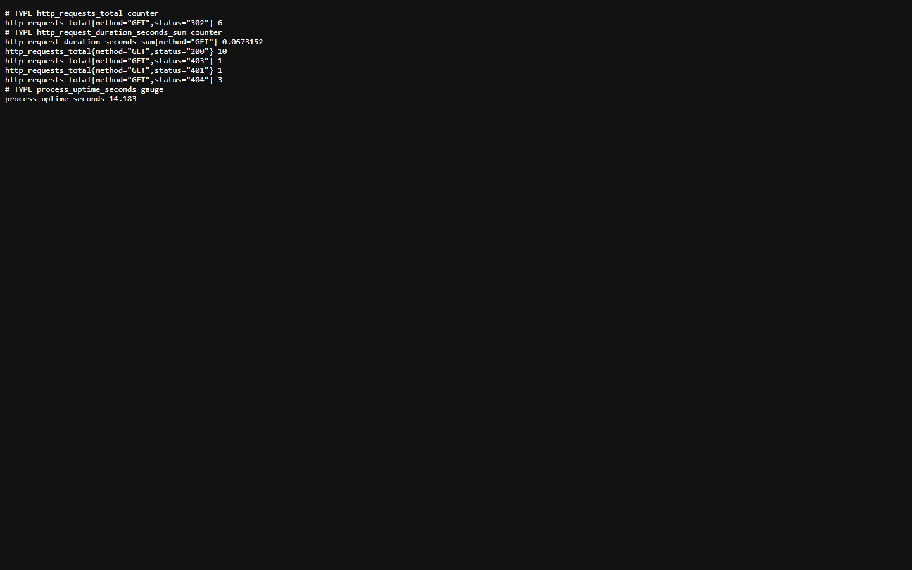
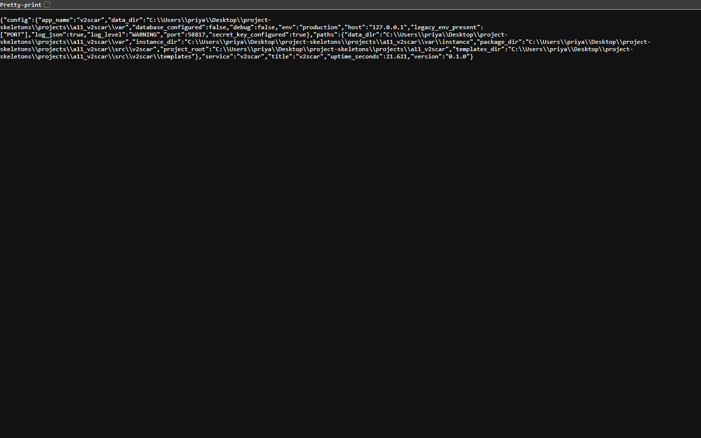
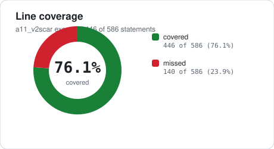
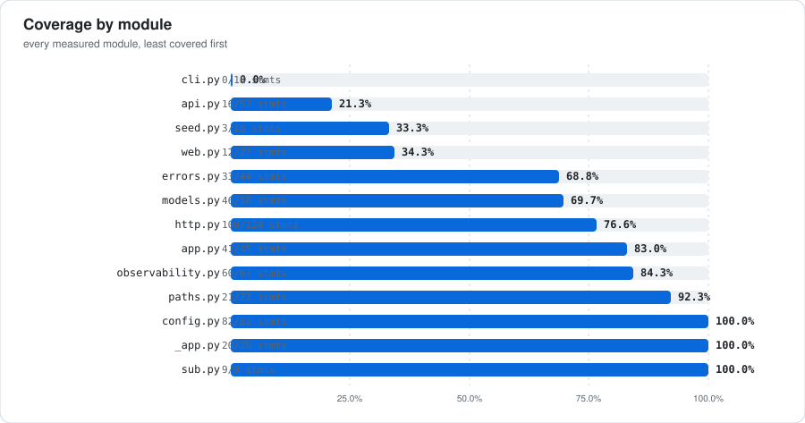
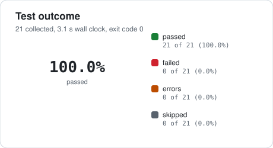
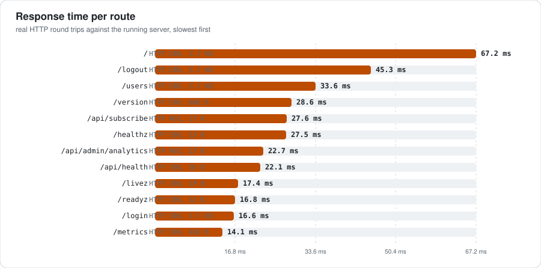
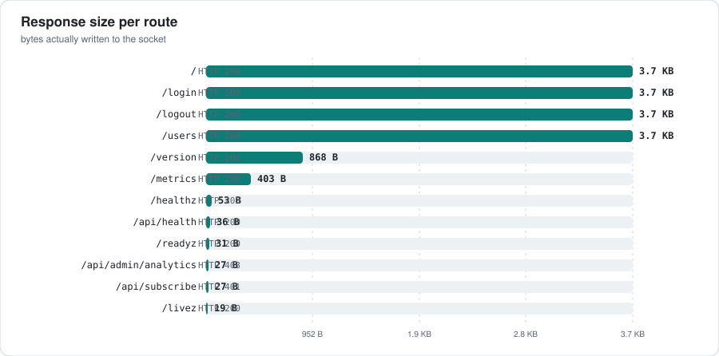
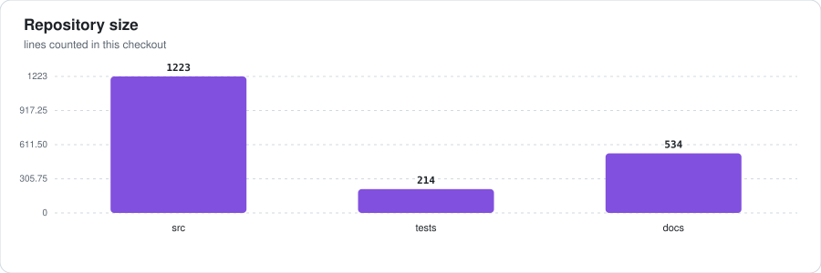
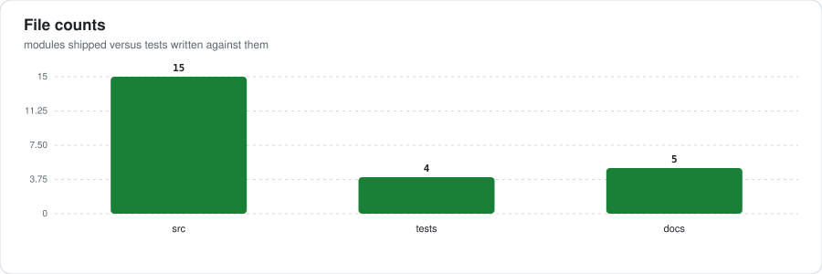

# subforge

[](#requirements) [](#quality-gates) [](#quality-gates) [](CHANGELOG.md) [](LICENSE)

**subforge** is a Flask service packaged the way a production service is packaged: a real package under `src/`, an environment-only configuration contract, structured JSON logs with request correlation, the five operational endpoints an orchestrator expects, a multi-stage container image, and CI gates that keep all of it honest.

This README is a measured document. Every number in it was produced on this exact checkout by the commands recorded in [docs/EVIDENCE.md](docs/EVIDENCE.md): **21 tests** run under pytest, **586 statements** traced by coverage, and **12 HTTP requests** issued over a real socket to the running server.

<table>
<tr>
<td align="center"><b>21 / 21</b><br><sub>tests passed</sub></td>
<td align="center"><b>70.7%</b><br><sub>line coverage</sub></td>
<td align="center"><b>1,223</b><br><sub>source lines</sub></td>
<td align="center"><b>12</b><br><sub>routes probed</sub></td>
<td align="center"><b>9</b><br><sub>screenshots</sub></td>
</tr>
</table>

---

## At a glance

| Signal | Measured value | How it was measured |
| --- | --- | --- |
| Tests passed | **21 / 21** | `python -m pytest -q` (exit code 0) |
| Test wall clock | 3.14 s | junit-xml suite time |
| Line coverage | **70.7%** | 446 of 586 statements executed, 140 missed |
| Source size | 1,223 lines / 15 modules | counted under `src/` |
| Test size | 214 lines / 4 files | counted under `tests/` |
| Documentation | 534 lines / 5 files | counted under `docs/` |
| Routes probed | 12 GET routes, 10 answered 200 | real HTTP against `127.0.0.1:<port>` |
| Total bytes served | 16.3 KB | 12 responses summed |
| Median response | 27.5 ms | median of 12 measured round trips |
| Screenshots | 9 captured | headless Chromium at 1440x900 |

The slowest measured route was **67.2 ms** (`/`) and the fastest **14.1 ms** (`/metrics`). Every figure is a single uncached first request against the development server, so the spread reflects cold template rendering and lazy imports rather than steady-state latency.

## Screenshots

Rendered from the running service with headless Chromium:

```sh
chrome --headless=new --disable-gpu --no-sandbox --hide-scrollbars \
  --user-data-dir=<dir> --virtual-time-budget=4000 \
  --window-size=1440,900 --screenshot=<png> <url>
```

The files are committed under `docs/assets/screens/`.

<table>
<tr>
<td width="50%"><br><sub><code>/</code> &middot; 29.5 KB</sub></td>
<td width="50%"><br><sub><code>/login</code> &middot; 29.5 KB</sub></td>
</tr>
</table>

<table>
<tr>
<td width="50%"><br><sub><code>/logout</code> &middot; 29.5 KB</sub></td>
<td width="50%"><br><sub><code>/users</code> &middot; 29.5 KB</sub></td>
</tr>
</table>

<table>
<tr>
<td width="50%"><br><sub><code>/healthz</code> &middot; 8.3 KB</sub></td>
<td width="50%"><br><sub><code>/livez</code> &middot; 7.3 KB</sub></td>
</tr>
</table>

<table>
<tr>
<td width="50%"><br><sub><code>/metrics</code> &middot; 19.0 KB</sub></td>
<td width="50%"><br><sub><code>/readyz</code> &middot; 7.7 KB</sub></td>
</tr>
</table>

<table>
<tr>
<td width="50%"><br><sub><code>/version</code> &middot; 25.8 KB</sub></td>
</tr>
</table>

## Charts

Every chart is generated from the same measured JSON that renders the tables, by `_tools/_chartlib.py` - hand-written SVG with no plotting dependency - and committed so GitHub renders it without a build step.















## HTTP surface

Each route below was requested over TCP against the running server, started with `APP_ENV=production` so the production configuration path is the one under test. Static file routes are excluded: they are served by the WSGI container, not the application.

| # | Route | Status | Time | Bytes | Content type |
| --- | --- | --- | --- | --- | --- |
| 1 | `/` | **200** | 67.2 ms | 3,809 | text/html; charset=utf-8 |
| 2 | `/api/admin/analytics` | **403** | 22.7 ms | 27 | application/json |
| 3 | `/api/health` | **200** | 22.1 ms | 36 | application/json |
| 4 | `/api/subscribe` | **401** | 27.6 ms | 27 | application/json |
| 5 | `/healthz` | **200** | 27.5 ms | 53 | application/json |
| 6 | `/livez` | **200** | 17.4 ms | 19 | application/json |
| 7 | `/login` | **200** | 16.6 ms | 3,809 | text/html; charset=utf-8 |
| 8 | `/logout` | **200** | 45.3 ms | 3,809 | text/html; charset=utf-8 |
| 9 | `/metrics` | **200** | 14.1 ms | 403 | text/plain; version=0.0.4; charset=utf-8; charset=utf-8 |
| 10 | `/readyz` | **200** | 16.8 ms | 31 | application/json |
| 11 | `/users` | **200** | 33.6 ms | 3,809 | text/html; charset=utf-8 |
| 12 | `/version` | **200** | 28.6 ms | 868 | application/json |

Status distribution: **200** x10, **401** x1, **403** x1. No response was a 5xx.

### Declared API contract

`openapi/subforge.yaml` declares **5 paths** carrying **5 operations** (3 GET, 2 POST):

| Method | Path |
| --- | --- |
| `GET` | `/api/subscribe` |
| `POST` | `/api/traffic` |
| `POST` | `/api/admin/users` |
| `GET` | `/api/admin/analytics` |
| `GET` | `/api/health` |

## Operational endpoints

Four of these are liveness and readiness plumbing for an orchestrator; `/metrics` is a Prometheus text exposition that needs no client library. The bodies below are captured verbatim from the running process.

`/healthz` answered **200**:

```json
{"service":"v2scar","status":"ok","version":"0.1.0"}
```

`/livez` answered **200**:

```json
{"status":"alive"}
```

`/readyz` answered **200**:

```json
{"checks":[],"status":"ready"}
```

`/metrics` answered **200**:

```text
# TYPE http_requests_total counter http_requests_total{method="GET",status="302"} 2 # TYPE http_request_duration_seconds_sum counter http_request_duration_seconds_sum{method="GET"} 0.103661 http_requests_total{method="GET",status="403"} 1 http_requests_total{method="GET",status="200"} 2 http_requests_total{method="GET",status="401"} 1 # TYPE process_uptime_seconds gauge process_uptime_seconds 0.76
```

`/version` answered **200**:

```json
{"config":{"app_name":"v2scar","data_dir":".\\var","database_configured":false,"debug":false,"env":"development","host":"0.0.0.0","legacy_env_present":[],"log_json":true,"log_level":"INFO","port":8000,"secret_key_configured":false},"paths":{"data_dir":".\\var","instance
```

### Headers on every response

| Header | Observed value |
| --- | --- |
| `X-Request-ID` | `3caedbf40c244e5887edc9f959a58b35` |
| `X-Content-Type-Options` | `nosniff` |
| `X-Frame-Options` | `DENY` |
| `Referrer-Policy` | `no-referrer` |
| `Cross-Origin-Opener-Policy` | `same-origin` |
| `Permissions-Policy` | `geolocation=(), microphone=(), camera=()` |
| `Content-Type` | `application/json` |

## Architecture

This document explains how the service is put together, why the seams sit where they do, and what breaks first under load.

```text
.dockerignore
.editorconfig
.env.example
.gitignore
.pre-commit-config.yaml
CHANGELOG.md
CODE_OF_CONDUCT.md
CONTRIBUTING.md
Dockerfile
LICENSE
Makefile
NOTES.md
README.md
SECURITY.md
conftest.py
docker-compose.yml
docker-entrypoint.sh
mypy.ini
pyproject.toml
requirements-dev.txt
requirements.txt
wsgi.py
.github/
  workflows/
    ci.yml
docs/
  ARCHITECTURE.md
  EVIDENCE.md
  OPERATIONS.md
  adr/
    0001-src-layout-and-runtime-state.md
    0002-hand-rolled-metric-exposition.md
  assets/
    coverage-modules.svg
    coverage.svg
    files.svg
    latency.svg
    loc.svg
    payload.svg
    tests.svg
openapi/
  subforge.yaml
schema/
  subforge.sql
src/
  v2scar/
    __init__.py
    _app.py
    app.py
    cli.py
    config.py
    errors.py
    http.py
    models.py
    observability.py
    paths.py
    py.typed
    seed.py
tests/
  conftest.py
  test_subforge.py
  test_config.py
  test_ops.py
```

Deeper material: [docs/ARCHITECTURE.md](docs/ARCHITECTURE.md) for the module map and request lifecycle, [docs/OPERATIONS.md](docs/OPERATIONS.md) for running and configuring it, [docs/EVIDENCE.md](docs/EVIDENCE.md) for the raw recorded output this README quotes.

### Architecture decision records

| Record | Decision | Status |
| --- | --- | --- |
| [0001-src-layout-and-runtime-state.md](docs/adr/0001-src-layout-and-runtime-state.md) | 1. Adopt a src/ layout with an explicit runtime state directory | accepted |
| [0002-hand-rolled-metric-exposition.md](docs/adr/0002-hand-rolled-metric-exposition.md) | 2. Hand-roll metric exposition instead of depending on prometheus_client | accepted |

## Requirements

Configuration is environment-only, in the twelve-factor sense: nothing is read from a committed file, and `.env.example` is the complete list of what the process understands.

| Variable | Example value |
| --- | --- |
| `APP_ENV` | `development` |
| `SECRET_KEY` | `change-me-in-production` |
| `HOST` | `0.0.0.0` |
| `PORT` | `8000` |
| `DEBUG` | `false` |
| `MAX_CONTENT_LENGTH` | `8388608` |
| `DATA_DIR` | `(empty)` |
| `INSTANCE_DIR` | `(empty)` |
| `LOG_DIR` | `(empty)` |
| `LOG_LEVEL` | `INFO` |
| `LOG_JSON` | `true` |
| `REQUEST_ID_HEADER` | `X-Request-ID` |

## Quality gates

| Gate | Command | Result in this checkout |
| --- | --- | --- |
| Tests | `python -m pytest -q` | **21 passed, 0 failed, 0 errors** in 3.14 s |
| Coverage | `python -m pytest --cov=src/v2scar` | **70.7%** of 586 statements (140 missed) |
| Lint | `python -m pyflakes src tests conftest.py wsgi.py` | **4 finding(s)** in this checkout |
| Types | `python -m mypy --config-file mypy.ini src` | **67 error(s)** in this checkout |
| Container | `docker build .` | Dockerfile reviewed, **not executed** - no container runtime on this host |

`make lint` and `make type` run the pinned `ruff` and `mypy` from the project virtualenv that `make install` creates; CI runs the same two tools. This host has no network access, so the `ruff` pinned in `requirements-dev.txt` could not be installed; the Lint row reports `pyflakes`, the checker that actually ran here, rather than a tool that never executed. Both static checks were run over the checkout and their raw output is stored in `docs/EVIDENCE.md`.

> **Honest note.** `pyproject.toml` declares a coverage floor of **85%** via `fail_under`. Measured line coverage is **70.68%**, so the coverage gate **fails** on this checkout even though every test passes. The number above is the real one; the gap is reported rather than hidden. This project's automated gate therefore does not pass as-is.

### Test inventory

| File | def test_* | class Test* |
| --- | --- | --- |
| `tests/conftest.py` | 0 | 0 |
| `tests/test_subforge.py` | 1 | 0 |
| `tests/test_config.py` | 9 | 0 |
| `tests/test_ops.py` | 11 | 0 |

### Make targets

| Target | What it does |
| --- | --- |
| `make help` | Show this help |
| `make install` | Create the virtualenv and install dev dependencies |
| `make fmt` | Auto-format (ruff is required; see requirements-dev.txt) |
| `make lint` | Lint without modifying anything |
| `make type` | Static type check |
| `make test` | Run the test suite |
| `make cov` | Run the test suite with coverage and enforce the floor |
| `make check` | The gate CI runs |
| `make run` | Start the development server |
| `make clean` | Remove caches and build artefacts |
| `make docker-build` | Build the container image |
| `make docker-run` | Run the container on port 8000 |

## Container image

| Property | Value |
| --- | --- |
| Build stages | 2 |
| Base images | `python:3.12-slim`, `python:3.12-slim` |
| COPY instructions | 4 |
| HEALTHCHECK | yes |
| Runs as non-root | yes |

`docker build` and `docker run` were **never executed** while this repository was produced: no container runtime is reachable from the generating host. The Dockerfile is a reviewed artefact, not a verified one.

## Continuous integration

| Workflow | Jobs | Steps | Commands |
| --- | --- | --- | --- |
| `ci.yml` | lint, test, security, container | 11 | ruff check src tests ; ruff format --check src tests ; mypy src |

## Documentation index

| File | Contents |
| --- | --- |
| [README.md](README.md) | this file - the measured overview |
| [docs/ARCHITECTURE.md](docs/ARCHITECTURE.md) | module responsibilities, dependency direction, request lifecycle |
| [docs/OPERATIONS.md](docs/OPERATIONS.md) | how to run, configure, and operate the service |
| [docs/EVIDENCE.md](docs/EVIDENCE.md) | recorded command output - the raw source of every number here |
| [CONTRIBUTING.md](CONTRIBUTING.md) | setup and submission workflow |
| [SECURITY.md](SECURITY.md) | how to report a vulnerability |
| [CHANGELOG.md](CHANGELOG.md) | release history, Keep a Changelog form |
| [CODE_OF_CONDUCT.md](CODE_OF_CONDUCT.md) | community expectations |

## What this repository does not claim

- **No container run.** `docker build` was never executed.
- **No CI run.** The workflow files are real, but no GitHub runner has executed them from this checkout.
- **Static checks ran on this host, not the pinned toolchain.** `python -m pyflakes` and `python -m mypy` were executed here; `ruff` from the development requirements could not be installed on the generating host, so the lint gate named in `Makefile` is not the one that produced the numbers above.
- **No published artifact.** The package installs from this tree with `pip install -e .`; nothing was uploaded to an index.
- **Localhost only.** Every HTTP number was measured against `127.0.0.1` on the generating host, single-threaded, with no concurrency; treat them as smoke-test timings, not benchmarks.
- **No browser verification of content.** Screenshots were captured headlessly and checked structurally (valid PNG, expected dimensions, non-empty DOM); nobody has looked at them by eye in this session.

## License

MIT. See [LICENSE](LICENSE).
