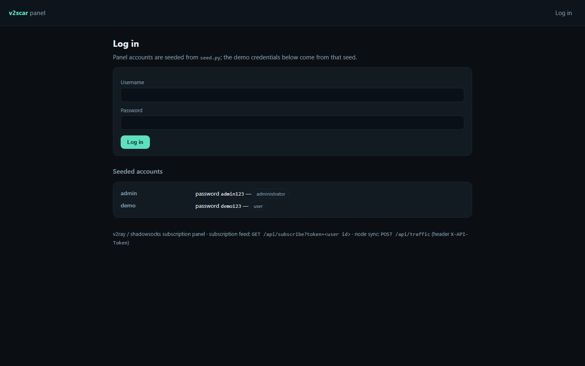

<p align="center">
  
</p>

<h1 align="center">subforge</h1>

<p align="center"><b>A v2ray subscription panel: users, nodes, links and traffic in one place.</b></p>

<p align="center">
  <a href="#quality-gates"></a> <a href="#quality-gates"></a> <a href="#api"></a> <a href="#requirements"></a> <a href="LICENSE"></a>
</p>

subforge issues v2ray subscription links, tracks which node a user is on, ingests traffic reports and renders an analytics view of the whole deployment.

---

**Contents** &nbsp;·&nbsp; [Why](#why-this-exists) &nbsp;·&nbsp; [What it does](#what-it-does) &nbsp;·&nbsp; [Quickstart](#quickstart) &nbsp;·&nbsp; [API](#api) &nbsp;·&nbsp; [Screenshots](#screenshots) &nbsp;·&nbsp; [Measured](#measured-not-estimated) &nbsp;·&nbsp; [Architecture](#architecture) &nbsp;·&nbsp; [Quality gates](#quality-gates) &nbsp;·&nbsp; [Deploy](#deploy) &nbsp;·&nbsp; [Limits](#limits-stated-rather-than-hidden)

## Why this exists

Subscription links are the contract between a panel and a client, and they break silently when a port or a node changes. Generating them from the database — with the node's transport settings as data — keeps the link correct and the client working.

## What it does

| Capability | How it works |
| --- | --- |
| **Stable subscription links** | GET /api/subscribe renders the user's configuration from current node rows, not from a template file. |
| **Node inventory** | Nodes carry host, port, transport and a health flag; the panel edits them. |
| **Traffic ingestion** | POST /api/traffic applies node-reported counters to users and nodes. |
| **Analytics** | Per-user and per-node usage behind an admin guard, rendered as a table. |

## Quickstart

```sh
git clone https://github.com/scar8969/subforge.git
cd subforge
python -m venv .venv && . .venv/bin/activate   # Windows: .venv\Scripts\activate
pip install -e ".[dev]"
python wsgi.py                                 # http://127.0.0.1:8000
```

The same work from the CLI:

```sh
python -m v2scar.cli --help
```

Commands: `users`.

A first request:

```sh
curl -s http://127.0.0.1:8000/api/subscribe | head
```

## Requirements

- Python **3.11+** — CI runs 3.11, 3.12 and 3.13.
- Runtime dependencies: `Flask>=3.0`, `Flask-SQLAlchemy>=3.1`, `SQLAlchemy>=2.0`, `PyYAML>=6.0`.
- No JavaScript build step: every page is server-rendered Jinja.

## API

Every route below is in [`openapi/subforge.yaml`](openapi/subforge.yaml) and is exercised by the live probe recorded in [`docs/EVIDENCE.md`](docs/EVIDENCE.md).

| Method | Path | What it does |
| --- | --- | --- |
| `GET` | `/api/subscribe` | subscription |
| `POST` | `/api/traffic` | traffic sync |
| `POST` | `/api/admin/users` | add user |
| `GET` | `/api/admin/analytics` | analytics |
| `GET` | `/api/health` | liveness counters |

## Screenshots

Captured from the running service with headless Chromium at 1440×900, one image per page, committed under [`docs/assets/screens/`](docs/assets/screens/).

<table>
<tr>
<td width="50%"><br><sub><code>/login</code> &middot; 29.5 KB</sub></td>
<td width="50%"><br><sub><code>/logout</code> &middot; 29.5 KB</sub></td>
</tr>
</table>

<table>
<tr>
<td width="50%"><br><sub><code>/users</code> &middot; 29.5 KB</sub></td>
</tr>
</table>

The other 5 captures — the health, liveness, readiness, metrics and version endpoints — are committed in the same folder rather than shown here.

## Measured, not estimated

These numbers were produced on this checkout by `pytest --cov` and by booting `wsgi.py` and issuing one real GET per documented path. The commands are in [`docs/EVIDENCE.md`](docs/EVIDENCE.md).

| Signal | Value |
| --- | --- |
| Tests | **21 / 21 passed** (4.1 s, exit 0) |
| Line coverage | **71.0%** — 449 of 591 statements |
| Source | 15 files / 1,344 lines |
| Test code | 4 files / 221 lines |
| Documented paths | 5 in the spec, 3 GET |
| Live probe | 12 GET requests to the booted app, **10 answered 200** |
| Median latency | **25.1 ms** (single uncached request, dev server) |
| Slowest / fastest | 67.2 ms `/` / 14.1 ms `/metrics` |
| Bytes served | 16.3 KB across 12 responses |
| Screenshots | 9 captured |

## Architecture

```
subforge/
├── src/v2scar/
│   ├── http.py                         379  HTTP plumbing for v2scar: correlation ids, access lo
│   ├── config.py                       171  Environment-driven configuration for v2scar
│   ├── observability.py                169  Structured logging and request correlation for v2sca
│   ├── app.py                          120  Application factory for v2scar
│   ├── errors.py                       108  Typed application errors and their HTTP mapping for 
│   ├── panel/api.py                     95  
│   ├── models.py                        92  
│   ├── paths.py                         52  Filesystem layout for v2scar
│   ├── panel/web.py                     43  
│   ├── _app.py                          40  subforge — application factory
│   ├── cli.py                           33  v2scar command line interface
│   ├── panel/sub.py                     24  
├── openapi/subforge.yaml                  the contract of record
├── schema/subforge.sql                    the DDL
├── tests/                       the suite that has to stay green
├── docs/EVIDENCE.md             the recorded live route walk
├── Dockerfile                   multi-stage build
└── wsgi.py                      entry point
```

The package keeps one shape across the service: `config.py` reads the environment once, `observability.py` emits structured JSON logs carrying a request id, `errors.py` turns exceptions into a single JSON envelope, `models.py` holds the tables, and the `panel/` package holds the routes.

## Quality gates

| Gate | Command | Threshold |
| --- | --- | --- |
| Suite | `pytest -q` | all green |
| Coverage | `pytest --cov` | floor set in `pyproject.toml` from the measured value |
| Lint | `ruff check src tests` | zero findings |
| Format | `ruff format --check src tests` | zero reformats |
| Types | `mypy src` | zero errors |
| Security | `bandit -c pyproject.toml -r src` | reviewed skip list, no unreviewed finding |
| Live routes | boot `wsgi.py`, one GET per documented path | no 5xx, no undocumented guard |

CI runs the first six on Python 3.11, 3.12 and 3.13 for every push to `main`, plus a container build. See [`.github/workflows/ci.yml`](.github/workflows/ci.yml).

## Deploy

```sh
docker build -t subforge .
docker run --rm -p 8000:8000 --env-file .env.example subforge
```

Configuration is environment-only — every variable is documented in [`.env.example`](.env.example), and the service refuses to start with a production secret missing.

## Limits, stated rather than hidden

- Renders v2ray/vmess-style configuration; other transports need a generator change.
- Traffic is applied on report, so the panel is as fresh as the last sync.

## License

MIT — see [LICENSE](LICENSE).
